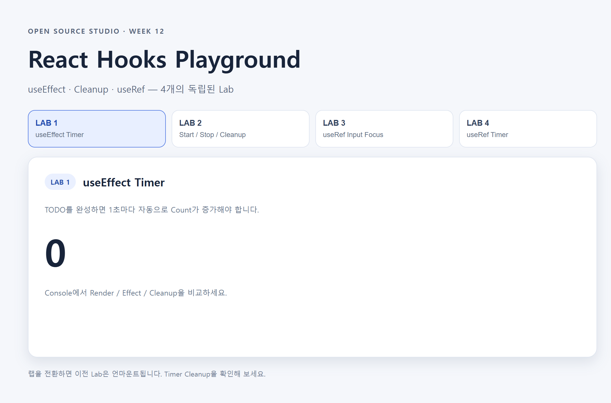

**1. Project Information:** 
> 이 프로젝트는 React의 useState, useEffect, useRef 등의 Hooks를 실습할 수 있는 프로젝트이다. 총 4개의 LAB이 존재하며 각 LAB마다 Hooks를 적절히 조합하여 타이머와 입력창 제어 등을 구현하고, 동작 원리를 이해하는데 도움을 주는 프로젝트이다. 
>
**2. Installation:**
> 설치 및 실행 방법 & 코드 수정 전 실행화면: <br>
> git clone -> 폴더로 이동(cd) -> npm install -> npm run dev 
> 
>
**3. Source Code Exploration:**
> **주요 파일 구조** 
> 1. App.jsx : 페이지의 전체적인 구조를 구성하고, 각 LAB의 정보를 저장하는 객체 배열 `labs`를 정의한다. 또한 사용자가 선택한 LAB에 해당하는 컴포넌트를 화면에 표시하는 기능을 담당한다.
> 2. Lab1_EffectTimer.jsx : useState와 useEffect를 이용하여 1초마다 숫자가 자동으로 증가하는 타이머를 구현한다. 또한 Cleanup을 통해 타이머를 정리할 수 있다.
> 3. Lab2_TimerControl.jsx : useState와 useEffect를 이용하여 타이머를 시작, 중지, 초기화하는 기능을 구현한다. 
> 4. Lab3_InputFocus.jsx : useRef를 이용해 입력창에 focus()를 적용하고 입력된 내용을 삭제하는 기능을 구현한다.
> 5. Lab4_RefTimer.jsx : useRef를 이용하여 타이머의 ID를 관리하고, 타이머의 시작, 중지, 초기화 기능을 구현한다. 또한 Cleanup을 이용하여 타이머를 정리한다.
>
> **useEffect**
> - Effect : useEffect가 실행될 때 특정 동작을 수행한다. Timer 실행 및 정리, 브라우저 이벤트 등록 및 제거 등의 작업에 사용된다.
> - Dependency Arry : useEffect의 실행 시점을 제어하는 배열이다. 배열을 생략하거나 []로 지정하는 등 사용 형태에 따라 Effect의 실행 시점이 달라진다.
> - Cleanup : 컴포넌트가 언마운트 되거나 의존성 변경으로 Effect가 다시 실행되기 전에 기존 작업을 정리한다. 예를 들어 setInterval을 사용하여 실행 중인 타이머를 종료할 수 있다.
>
> **useRef**
> - useRef는 .current 속성에 값을 저장할 수 있다. useState와 동일하게 리렌더링 후에도 값이 유지되지만, useRef는 .current의 값이 변경되어도 리렌더링이 발생하지 않는다는 것이 특징이다. 
>
> **useEffect와 useRef 관련 각 주요 코드 설명**
> ```jsx
> const [count, setCount] = useState(0);
> const [running, setRunning] = useState(false);
>
> useEffect(() => {
>   if (!running) {
>     return;
>   }
>
>   const id = setInterval(() => {
>     setCount(prev => prev + 1);
>   }, 1000);
>
>   return () => clearInterval(id);
> }, [running]);
> ```
> 이 코드는 타이머의 시작과 중지를 구현한 코드이다. 우선 running State를 초기값 false로 선언한다. Effect가 실행된 후 running이 false이면 타이머를 생성하지 않고 종료하며, true이면 `setInterval`이 실행되어 1초마다 count를 1씩 증가시킨다. 생성한 타이머 id는 `id`에 저장된다. running이 변경되어 Effect가 다시 실행되기 전이나 언마운트 될 때 Cleanup이 실행되고, `clearInterval(id)`를 호출하여 기존의 타이머를 종료한다.
> ```jsx
> const inputRef = useRef(null);
>
> const focusInput = () => {
>   inputRef.current.focus();
> };
>
> const clearInput = () => {
>   inputRef.current.value = '';
>   inputRef.current.focus();
> };
> 
> <input id="student-name" className="field" placeholder="Enter your name" ref={inputRef}/>
> ```
> 이 코드는 useRef를 이용하여 입력창 Focus와 Clear를 구현하는 코드이다. 우선 useRef(null)을 이용하여 Ref를 생성하고, ref={inputRef}를 통해 입력창과 연결한다. 이후 사용자가 Focus 버튼을 클릭하면 `focusInput`이 실행되고, inputRef.current.focus()로 입력창으로 커서를 이동시킨다. 사용자가 Clear 버튼을 클릭하면 `clearInput`이 실행되고, 입력창의 내용을 비우고 커서를 이동시킨다.
>
**4. Lab Implementation:**
> **LAB 1. useEffect Timer**
> - 구현 내용 : useEffect와 setInterval을 이용하여 1초마다 Count가 1씩 증가하는 타이머와 Cleanup을 이용한 타이머 종료 기능을 구현함
> - 실행 결과 : Count가 1초마다 1씩 증가하고, 다른 LAB으로 이동하면 타이머가 종료됨
>
> **LAB 2. Timer Start / Stop**
> - 구현 내용 : running State와 useEffect를 이용하여 타이머를 시작, 중지, 초기화하는 기능을 구현함
> - 실행 결과 : Start, Stop, Reset 버튼을 클릭하면 해당 버튼에 해당하는 기능이 실행되고 타이머 중복 실행이 발생하지 않음
>
> **LAB 3. Input Focus with useRef**
> - 구현 내용 : useRef를 이용하여 입력창 Focus와 Clear 기능을 구현함
> - 실행 결과 : Focus 버튼을 클릭하면 입력창으로 커서가 이동하고, Clear 버튼을 클릭하면 입력창의 내용이 삭제되고 입력창으로 커서가 이동함
>
> **LAB 4. Timer with useRef**
> - 구현 내용 : useRef를 이용하여 타이머 ID를 관리하고 시작, 중지, 초기화 기능과 Cleanup 기능을 구현함
> - 실행 결과 : Start, Stop, Reset 버튼을 클릭하면 해당 버튼에 해당하는 기능이 실행되고, 다른 LAB으로 이동 시 타이머가 종료됨
>
**5. Lab Comparison:**
> **1. useEffect의 Dependency Array가 필요한 이유는?** <br>
> Effect가 다시 실행되는 시점을 제어하기 위해서. 즉, 불필요한 Effect의 실행을 방지하기 위해 필요하다.
>
> **2. Cleanup을 사용하지 않으면 어떤 문제가 발생할 수 있는가?** <br>
> Cleanup을 사용하지 않으면 컴포넌트가 언마운트되거나 Effect가 다시 실행되기 전에 기존 작업이 종료되지 않을 수 있다. 그렇게 되면 다른 LAB으로 이동해도 기존 타이머가 종료되지 않고 계속 실행되고, 이 외에도 Effect가 다시 실행될 때 여러 문제가 발생할 수 있다.
>
> **3. useState와 useRef의 가장 중요한 차이는?** <br>
> useState와 useRef의 가장 중요한 차이는 useState는 값이 변경되면 리렌더링이 발생하지만, useRef는 값이 변경되어도 리렌더링이 발생하지 않는다는 것이다.
>
> **4. LAB 2와 LAB 4의 Timer 관리 방식은 어떻게 다른가?** <br>
> LAB 2는 `running State`와 `useEffect`를 이용하여 타이머를 관리한다. running이 true이면 Effect에서 타이머를 생성하고, false이면 Cleanup을 통해 타이머를 종료한다. LAB 4는 `useRef.current`에 타이머 ID를 저장하고, Start와 Stop 함수를 이용하여 타이머를 생성하고 종료한다.
>
**6. Customizing:**
> **프로젝트 제목 또는 설명 변경 (src/App.jsx)**
> 1. <p>의 내용을 '오픈소스 스튜디오 · 12주차'로 변경 
> 2. \<h1>의 내용을 '안재용's React 실습 공간'으로 변경
> 
> **CSS 스타일 2곳 이상 변경 (src/App.css)**
> 1. .tab의 background를 white -> rgb(242, 250, 226)로 변경
> 2. .tab span의 color를 #637086 -> #ef4494로 변경
>
> <br>**선택 기능 : Timer Count를 분/초 형식으로 표시 기능
(src/components/Lab2_TimerControl.jsx, Lab4_RefTimer.jsx)**
> - 기존의 초 단위로만 표시되던 Timer Count를 분/초 형식으로 표시되도록 코드를 추가, 변경함. 예) 65초 -> 1:05
>
<br>**7. Deployment:** [Vercel URL](https://22400422-assign12.vercel.app/)

**8. Weekly Review:**
> **새롭게 배운 내용 3가지**
> 1. Cleanup : 이전 Effect가 수행한 작업을 정리하기 위해 사용한다. clearInterval, 네트워크 요청 취소, 외부 시스템 연결 해제 등을 할 때 사용된다. 
> 2. useState와 useRef의 차이점 : 두 Hook 모두 리렌더링 시에는 값을 유지할 수 있다. 가장 큰 차이점은 useState는 State를 변경하면 리렌더링이 발생하지만, useRef는 .current의 값을 변경해도 리렌더링이 발생하지 않는다.
> 3. useEffect의 Dependency Array가 필요한 이유 : Effect가 다시 실행되는 시점을 제어하기 위해 필요하다. []이면 마운트 시 실행되고, [running]이면 마운트 시와 running 값이 변경될 때 실행된다. 또한 []를 생략하면 컴포넌트가 렌더링될 때마다 Effect가 다시 실행된다. 
>
> **어려웠던 점과 해결 방법**
> - 어려웠던 점: useEffect의 Cleanup이 동작하는 원리가 헷갈렸다.
> - 해결방법: AI에게 해당 코드의 동작 원리를 질문하여 setInterval이 반환하는 타이머 ID를 clearInterval에 전달하면 Timer가 종료된다는 것을 이해할 수 있었다. 또한 다른 LAB으로 이동하면 Cleanup이 동작하여 Timer가 종료된다는 것을 이해하였다.
>
> **AI 활용 내용 및 느낀 점**
> - AI 활용 내용
>   1. useEffect의 Cleanup 동작 원리 이해 : `return () => clearInterval(id)`의 동작 원리를 질문하였다. 이 과정에서 타이머 ID를 저장하는 이유와 Cleanup이 실행되는 시점 등을 이해하였다.
>   2. 초 단위의 Count를 분/초 단위로 변경하는 방법을 질문하였다. `Math.floor()`을 사용하는 방법을 알게 되어 코드를 작성하는데 도움이 되었다.
> - 느낀점: 저번 과제에 이어 두 번째로 React 분석 + 코드 작성 과제를 하니까 React의 구조와 동작에 대해 제대로 알게 되었다. 특히 useEffect와 useRef를 직접 활용해보며 Hook의 동작 원리를 좀 더 명확하게 이해할 수 있었다. 
> 